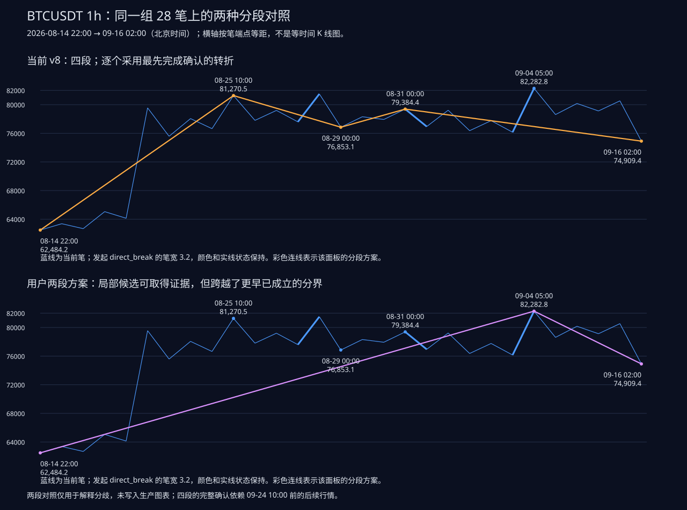

# BTCUSDT 1h：2026-08-14 22:00—09-16 02:00 四段原因复核

**后续审查更正：四段的数值和历史截面仍有效；但前两处分界的 `direct_break=false` 是 v8 比较边界错误造成的漏判，不能当作正确规则分类。现已发布 [v9 修复](../direct_break_fix_20261013/report.md)：前两处改为第一笔破坏确认并补齐发起笔标记，四段端点与证据仍不变。下文及对照图保留 v8 审查记录；[专项审查](../direct_break_audit_20261013/report.md)说明错误原因。**

审核对象是原路径 `reports/BTCUSDT_20260606_20261013_five_periods/btc_tradingview.html` 及其 `analysis_1h.json`、冻结小时 OHLC；规则为修复后的 **v8**，报告截止北京时间 **2026-10-13 10:10**。本文时间均为北京时间，价格单位为 USDT。P 编号是完整历史笔数组从 0 开始的索引，不是展示区间的笔序号。

**结论：在当前笔序列与“最先取得完整证据的转折优先”规则下，该区间划为四段有可复核的触发依据。前两个内部转折分别是无缺口顶、底分型；第三个内部转折是包含型一笔破坏后，第三笔进一步突破。09-04 05:00 的高点出现时，前三段已经取得确认。后来的更高点没有让程序撤销此前的分界。**

用户提出的两段方案并非价格跨度不合法：两个跨度分别有 23 笔、5 笔，而且单独检验候选转折，也都能得到后续证据。它未被全局分段采用的原因，是它跨越了更早已经成立的分界。需要区分“这个端点单独能否成为候选”与“从既定起点依次分段时应采用哪一个候选”。

**时间上还有一个关键区别：09-16 02:00 当时只有前三段确认；第四段以这时为几何终点，但直到 09-24 10:00 才确认。** 当前截图是截至 10-13 的结构结果，不能用它代表 09-16 当时已知的全部结构。



图中横轴按笔端点等距，用于看结构关系，不是等时间 K 线图。两段对照没有写入生产图表。[当前实际 K 线截图](../../reports/BTCUSDT_20260606_20261013_features_v8/1h_audit_2026-08-14.png)。

## 1. 四段的完整清单

| 段 | 起点 → 终点 | 端点价格 | 组成笔 | 笔数 | 结束依据 | 确认时间 |
|---|---|---|---|---:|---|---|
| A 上 | 08-14 22:00 → 08-25 10:00 | 62,484.2 → 81,270.5 | P1586—P1594 | 9 | 无缺口顶分型 | 08-27 12:00 |
| B 下 | 08-25 10:00 → 08-29 00:00 | 81,270.5 → 76,853.1 | P1595—P1599 | 5 | 无缺口底分型 | 08-31 08:00 |
| C 上 | 08-29 00:00 → 08-31 00:00 | 76,853.1 → 79,384.4 | P1600—P1602 | 3 | 一笔破坏后第三笔继续突破 | 09-02 14:00 |
| D 下 | 08-31 00:00 → 09-16 02:00 | 79,384.4 → 74,909.4 | P1603—P1613 | 11 | 有缺口底分型＋反向顶分型 | 09-24 10:00 |

总计 **28 笔，9＋5＋3＋11**。四段首尾端点、时间、笔索引都相接；HTML 中的四个节点与分析输出逐个一致，没有绘图器额外分段。

四段前三笔的重叠区间分别是 `[62,681.1, 63,370.0]`、`[77,808.1, 79,200.0]`、`[77,933.4, 78,314.9]`、`[76,947.2, 79,228.5]`，均非空；段末端分别满足本程序的方向极值条件。

## 2. 为什么 A 在 08-25 10:00 结束

向上段取向下笔作为特征元素。转折前最后两个相关元素为：

- P1591：`[75,588.0, 79,555.5]`。
- P1593：`[76,649.0, 78,057.6]`，被前者包含。

按当时向上方向处理包含，低点取较高值、高点取较高值，得到左标准元素 `[76,649.0, 79,555.5]`。

| 元素 | 来源 | 标准区间 |
|---|---|---|
| 左 | P1591＋P1593 | `[76,649.0, 79,555.5]` |
| 中 | P1595，08-25 10:00 → 08-26 05:00 | `[77,808.1, 81,270.5]` |
| 右 | P1597，08-26 10:00 → 08-26 23:00 | `[77,600.0, 79,200.0]` |

中元素的高点和低点分别高于两侧：

```text
81,270.5 > max(79,555.5, 79,200.0)
77,808.1 > max(76,649.0, 77,600.0)
```

左、中交集为 `[77,808.1, 79,555.5]`，**没有缺口**。反向三笔 `81,270.5 → 77,808.1 → 79,200.0 → 77,600.0` 也已成立。因此 P1597 在 08-27 12:00 完成时，程序确认 A 段结束。

这里 `direct_break=false`，走的是普通无缺口顶分型分支，并不需要等第二特征序列。后来 08-28 出现 81,500.0、09-04 出现 82,282.8，均晚于本次确认。

## 3. 为什么 B 在 08-29 00:00 结束

向下段取向上笔为特征元素。P1596 的 `[77,808.1, 79,200.0]` 被 P1598 的 `[77,600.0, 81,500.0]` 包含；按向下方向合并，得到 `[77,600.0, 79,200.0]`。

| 元素 | 来源 | 标准区间 |
|---|---|---|
| 左 | P1596＋P1598 | `[77,600.0, 79,200.0]` |
| 中 | P1600，08-29 00:00 → 08-30 03:00 | `[76,853.1, 78,314.9]` |
| 右 | P1602，08-30 18:00 → 08-31 00:00 | `[77,933.4, 79,384.4]` |

底分型不等式：

```text
76,853.1 < min(77,600.0, 77,933.4)
78,314.9 < min(79,200.0, 79,384.4)
```

左、中交集为 `[77,600.0, 78,314.9]`，没有缺口。反向三笔 `76,853.1 → 78,314.9 → 77,933.4 → 79,384.4` 成立，在 **08-31 08:00** 确认。

这里同样 `direct_break=false`，是普通无缺口底分型。

一个容易产生误解的细节是：B 段内部 08-28 09:00 的 **81,500.0** 高于起点 **81,270.5**。程序确实允许这种情况。具体过程为：

1. 假设 B 在 08-26 23:00、77,600.0 结束。
2. 从该点上来的 P1598 到 81,500.0，触发第一笔破坏。
3. 随后的 P1599 已跌至 76,853.1，低于假设转折低点 77,600.0；这个转折在反向成段前失效。
4. 因此没有形成新的上段，B 继续向下延伸至 08-29 00:00。

合并特征元素时得到的高点 79,200.0 是判定分型用的标准值，不是声称 81,500.0 没有发生。程序另存 `range_high=81,500.0`，保留真实价格范围。

## 4. 为什么 C 在 08-31 00:00 结束

这一处分界不能用普通严格顶分型解释。左特征元素 P1601 为 `[77,933.4, 78,314.9]`；第一反向笔 P1603 为 `[76,947.2, 79,384.4]`，包含左元素。

按当前特殊分支，先比较第一反向笔与旧元素：

```text
P1603 终点 76,947.2 < 旧元素低点 77,933.4
```

这时只标记“一笔破坏”，尚不能确认 C 结束。后续三笔为：

| 相对位置 | 笔 | 价格 |
|---|---|---|
| 第一反向笔 | P1603 | 79,384.4 → 76,947.2 |
| 第二笔 | P1604 | 76,947.2 → 79,228.5 |
| 第三筆 | P1605 | 79,228.5 → 76,368.0 |

第三笔的终点 **76,368.0 < 76,947.2**，严格突破第一反向笔终点。三笔重叠、反向跨度成立，P1605 在 **09-02 14:00** 完成时才确认 C 结束。

该处审计状态是 `confirmed_direct_break`；普通 `first_pattern_found` 为 false。输出沿用 `confirmation=no_gap` 这个粗分类，但具体理由必须查破坏事件。把它误读成“第三个普通无缺口顶分型”会解释错。

应加粗的是发起破坏的 **P1603**，不是整条 C 或 D 段；线宽 3.2，颜色与实线状态保持。

## 5. 为什么 D 没在 09-02 18:00 结束，也没改从 09-04 05:00 开始

D 的早期候选低点先是 09-02 02:00 的 76,368.0，随后被 P1607 的 76,151.9 下破，所以前一个候选失效。

更关键的是以 **09-02 18:00、76,151.9** 为转折的假设。P1608 上涨至 **09-04 05:00、82,282.8**，已构成第一笔破坏；接下来价格为：

```text
76,151.9 → 82,282.8 → 78,618.1 → 80,167.0
                         → 79,125.3 → 80,536.1 → 74,909.4
```

若要按这个特殊分支确认新的上段，后续向上延伸需要突破首笔终点 **82,282.8**。实际第三筆最高 **80,167.0**，第五笔最高 **80,536.1**，均未突破。最终 P1613 先跌破首笔起点 **76,151.9**，到达 **74,909.4**，该转折假设失效。

所以程序保留 D 从 **08-31 00:00** 开始，视为第一笔破坏后原下段继续延伸，而没有先确认一条 09-02 → 09-04 的上段，再新开 09-04 → 09-16 的下段。

这也解释了最不直观的地方：D 的起点只有 **79,384.4**，段内却出现 **82,282.8**。项目的段合法性检查只强制终点为方向极值，并将内部完整范围另存为 `[74,909.4, 82,282.8]`；不强制起点也是全段反向极值。**此前讨论的“笔两端为全跨度极值”是选笔规则，不可直接套用为当前程序的线段起点规则。**

对应代码：[段跨度条件](/root/chan/chan_structure.py:104)、[转折极值被越过即失效](/root/chan/chan_structure.py:145)、[第一笔破坏等待分支](/root/chan/chan_structure.py:168)。这项“允许段内越过旧起点”的实现是项目对延续规则的具体解释，不应仅靠画面不直观就判错，也不能以程序自洽代替对全部理论的证明。

## 6. D 在 09-16 02:00 的终点如何最终确认

D 是向下段，取向上笔作为特征元素：

| 元素 | 来源 | 区间 |
|---|---|---|
| 左 | P1612 | `[79,125.3, 80,536.1]` |
| 中 | P1614 | `[74,909.4, 76,275.4]` |
| 右 | P1616 | `[75,025.0, 81,933.9]` |

中元素高、低均低于两侧，构成底分型；但 **76,275.4 < 79,125.3**，左、中之间有 **2,849.9** 的特征缺口。它是特征元素的区间缺口，不是说中间没有成交或 K 线缺根。

P1616 在 09-20 08:00 完成，只足以确认第一组底分型。还须检查从 09-16 低点出发的反向上涨走势，其向下特征笔随后形成：

| 反向序列元素 | 来源 | 区间 |
|---|---|---|
| 左 | P1617 | `[80,095.9, 81,933.9]` |
| 中 | P1619 | `[85,080.0, 87,385.1]` |
| 右 | P1621 | `[83,450.1, 87,247.3]` |

中元素高点 **87,385.1**、低点 **85,080.0** 都高于左右对应值，顶分型成立。因此，直到 P1621 在 **09-24 10:00** 完成，D 才获得 `gap_reverse_fractal` 确认。

这三个反向元素无须另等一次“第三序列”，第二特征分型自身有没有缺口不影响当前分支的确认。此处确实检查了第二序列，未重复 v8 修复前跳过该条件的问题。

## 7. 对用户两段方案的实测，而非直接否定

用户方案为：

1. **08-14 22:00 → 09-04 05:00**：62,484.2 → 82,282.8，共 P1586—P1608，23 笔。
2. **09-04 05:00 → 09-16 02:00**：82,282.8 → 74,909.4，共 P1609—P1613，5 笔。

两个跨度都满足 `_valid_span` 的必要条件；第二个跨度前三笔交集为 `[79,125.3, 80,167.0]`。不能说它们“因为跨度或前三笔不合法而被拒绝”。

进一步单独调用转折判定，第一候选在 09-04 的标准元素为：

| 元素 | 来源 | 区间 |
|---|---|---|
| 左 | P1607 | `[76,151.9, 77,767.8]` |
| 中 | P1609＋P1611 | `[79,125.3, 82,282.8]` |
| 右 | P1613＋P1615 | `[74,909.4, 76,275.4]` |

这是一组有缺口顶分型；反向序列 P1612、P1614、P1616 构成底分型。因此单独保留这个“08-14 起点尚未分段”的假设，会在 **09-20 08:00** 得到结束于 09-04 05:00 的证据。第二候选的 09-16 终点也会在 **09-24 10:00** 得到证据。

但程序不是在全部未来高低点里选一个最长跨度。它从同一起点收集候选，优先选证据笔最早者，然后从该转折接着分下一段。关键对照如下：

| 假设上段都从 08-14 22:00 开始 | 候选端点 | 局部证据笔 | 证据可用时间 | 为什么未替换当前 A |
|---|---|---|---|---|
| 当前 A | 08-25 10:00，81,270.5 | P1597 | 08-27 12:00 | 最早完成确认，先被采用 |
| 更晚候选 | 08-28 09:00，81,500.0 | P1605 | 09-02 14:00 | 晚于 A |
| 用户第一段 | 09-04 05:00，82,282.8 | P1616 | 09-20 08:00 | 晚于 A，且跨越 B、C 已有分界 |

在这个起点下，08-18 22:00、08-21 16:00 两个更早高点候选均在完成确认前被新高突破，失效；所以不是任意选中 08-25。相关候选和拒绝原因均保存在 `evidence.json` 的 `first_origin_candidates`。

决定全局采用次序的代码是 [build_segments](/root/chan/chan_structure.py:264)，尤其是候选以 `(evidence_index, turn_index)` 取最小值，以及采用后执行 `start = turn`。**两段方案要成为实际输出，就必须解释为何应取消 08-25、08-29、08-31 已成立的分界，或改变底层笔序列；仅证明 09-04 是更高点不足以做到这一点。**

## 8. 原始 OHLC 历史截面复核

不是从最终笔列表简单裁切：每个时刻都只取截至当时已收盘的原始 1h K 线，保留 2023 年起的预热历史，重新做包含、分型、连续选笔，再划段。

| 截止时刻 | 指定区间内已确认段数 | 说明 |
|---|---:|---|
| 08-27 11:00 | 0 | A 尚未确认 |
| 08-27 12:00 | 1 | A 确认 |
| 08-31 07:00 | 1 | B 尚未确认 |
| 08-31 08:00 | 2 | B 确认 |
| 09-02 13:00 | 2 | C 尚未确认 |
| 09-02 14:00 | 3 | C 确认 |
| 09-04 13:00 | 3 | 新高笔完成，但尚无反向上段确认 |
| 09-16 02:00 | 3 | D 待确认，当时有效候选末端仍在 09-02 18:00 |
| 09-16 23:00 | 3 | 长下笔完成，D 候选端点推进至 09-16 02:00 |
| 09-24 09:00 | 3 | 第二特征序列仍缺最后完成笔 |
| 09-24 10:00 | 4 | D 确认 |

以上是 11 个独立截面，包括四个证据时刻及其前一小时；不是宣称遍历了区间每一个小时。当前选笔政策允许历史后缀修订，9 月长下笔相关修订不应被误说成当时一直存在相同长笔。本次截面结果明确记录了这一时序差别。

## 9. 复核结论的边界

- 四段图形确实来自结构算法，不是 HTML 多画两段或时间轴误连。
- 已从原始 K 线检查 P1586—P1621 共 36 笔：端点原始极值、去包含中心间距、全笔范围极值、交替与连续性全部通过；其中前 28 笔构成指定区间，后 8 笔用于后续确认证据。
- A、B 的标准缺口均为 false；C 使用明确的直接破坏特殊分支；D 标准缺口为 true，确实等待了反向分型。因此本区间没有复现前次 v8 修复的两类错误。
- “当前规则能逐项推出四段”与“已证明所有缠论画法只能是四段”是两种强度不同的结论。本报告支持前者；没有用当前算法自证整个理论，也没有将用户两段方案简单说成几何上不合法。
- 本轮只生成分析材料，没有修改生产算法、笔段结果或原 HTML。

## 10. 规则出处、代码与复现材料

理论核对采用课程原文转载：[第 65 课](https://chanlun108.cn/chanzhongshuochan108ke/65.html) 的包含方向与三笔重叠；[第 67 课](https://chanlun108.cn/chanzhongshuochan108ke/67) 的标准特征分型和两类确认；[第 71 课](https://chanlun108.cn/chanzhongshuochan108ke/71.html) 的第一笔破坏后延伸或失效；[第 81 课](https://chanlun108.cn/chanzhongshuochan108ke/81.html) 对第二序列包含的更正。上文数字、不等式和候选优先次序分别来自冻结数据及项目代码。

- [完整证据 JSON](evidence.json)：四段、候选、标准特征序列、输入笔、11 个历史截面、源数据及算法哈希。
- [36 笔明细 CSV](strokes.csv)：起止时间、价格、完成时间、去包含 K 线数量、破坏笔标记。
- [独立复核脚本](check.py) · [运行日志](check.log)。
- [四段／两段对照图](comparison.svg) · [绘图脚本](draw.py)。

复现命令：

```bash
python3 diagnostics/btc_1h_20260814_20260916_segments/check.py
python3 diagnostics/btc_1h_20260814_20260916_segments/draw.py
```
